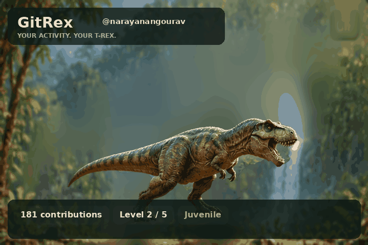

# GitRex 🦖

**A T-Rex evolves through five levels.** GitRex creates an animated level roadmap for a profile README. This release ships new **AI-generated, original-to-this-project dinosaur and forest illustrations**, plus a separately authored **fully procedural** asset set. No images from the earlier user-uploaded T-Rex photo are bundled.

> **Version 2.0.0** · Python 3.10+ · MIT · Offline preview · GitHub Actions · No paid server required



**Note:** This animation reflects the current level from the latest successful update. It displays completed levels, the current level, and the next stage.

## Try it without installing anything

1. Download and **extract** the ZIP to a folder.
2. Double-click `OPEN_PREVIEW.html`. Move the contributions slider to grow the dinosaur.
3. Open `output/preview.html` to see the pre-rendered GIF.

The browser preview is self-contained HTML/JS and uses local images. You do not need Node, a backend server, credentials, or an internet connection.

## Regenerate the demo animation (Windows)

Install Python 3.10+ and double-click `RUN_DEMO.bat`. It builds a local `.venv`, installs Pillow and regenerates `output/trex.gif`, `output/trex.png`, `output/preview.html`, and `output/summary.json`.

Or in PowerShell:

```powershell
py -3 -m venv .venv
.venv\Scripts\python.exe -m pip install -r requirements.txt
$env:PYTHONPATH = "src"
.venv\Scripts\python.exe -m gitrex demo --output-dir output
```

## Use live GitHub data

1. Install [GitHub CLI](https://cli.github.com/) and Python 3.10+.
2. Run `gh auth login` in PowerShell. Do **not** write tokens into `.env` files or commit them.
3. Double-click `RUN_LIVE.bat`; enter your public GitHub login.
4. Review the level roadmap in `output/summary.json` and the GIF. Live collection fails rather than silently falling back to demo figures.

PowerShell alternative after setting up Python:

```powershell
$env:PYTHONPATH = "src"
$env:GH_TOKEN = gh auth token
.venv\Scripts\python.exe -m gitrex live --login narayanangourav --output-dir output
Remove-Item Env:GH_TOKEN
```

You can also run `collect` and `render` separately:

```powershell
$env:PYTHONPATH = "src"
$env:GH_TOKEN = gh auth token
.venv\Scripts\python.exe -m gitrex collect --login narayanangourav --output snapshot.json
.venv\Scripts\python.exe -m gitrex render snapshot.json --output-dir output
Remove-Item Env:GH_TOKEN
```

`snapshot.json` is ignored in Git because it may contain account activity details. The published `output/summary.json` contains only the level roadmap, stage descriptions, and current/next markers.

## GitHub profile integration

This project is designed for **a separate `GitRex` repository**. The daily workflow regenerates and commits assets in that repository. Add this to the `README.md` in your **profile repository** (for example `narayanangourav/narayanangourav`):

```markdown
## My GitRex


```

See **[docs/PUBLISHING.md](docs/PUBLISHING.md)** for copyright checks, Git setup, secure Actions settings and profile integration. The first live workflow run succeeded and committed the current output files to `master`.

## Growth rules

| Level | Stage | Description |
|---:|---|---|
| 0 | Hatchling | Beginning the journey |
| 1 | Juvenile | Growing stronger |
| 2 | Subadult | Building experience |
| 3 | Adult | A mature, steady stage |
| 4 | Apex Rex | The highest evolution |

The roadmap marks earlier stages as complete, highlights the current stage, and labels the next stage as the future goal. Level numbers start at 0.

Yesterday's completed UTC-day activity selects the motion mode (`idle`, `walk`, `roar`). All modes use light body movement and breathing of the same illustrated sprite. **This release does not have individually animated limbs or a moving jaw.** The top language is derived approximately from public owned repositories.

## Architecture

```text
GitRex/
├── .github/workflows/gitrex.yml   # nightly regeneration, manual trigger
├── assets/
│   ├── forest_original.png        # reproducible original background
│   ├── trex_original.png          # reproducible original foreground sprite
│   └── demo_snapshot.json         # invented sample data, clearly labeled
├── src/gitrex/
│   ├── github.py                  # API data collection
│   ├── model.py                   # deterministic growth/streak calculations
│   ├── render.py                  # layered GIF/PNG renderer
│   └── cli.py                     # commands
├── tools/prepare_illustration.py   # offline sprite extraction from bundled generated art
├── tools/generate_procedural_art.py  # entirely source-drawn fallback
├── tests/                        # offline Python tests
├── docs/PUBLISHING.md             # publication checklist
├── ASSET_PROVENANCE.md            # proof and licensing notes
├── LICENSE                        # MIT
├── OPEN_PREVIEW.html              # no-install local growth simulator
├── RUN_DEMO.bat / RUN_LIVE.bat     # Windows launch scripts
└── output/                       # example rendered animation
```

## Cost, privacy and limitations

- No server, paid AI image API, or private token in the repo is needed.
- GitHub Actions' standard runners are available without runner-minute charges for public repositories under current published terms; review GitHub's current usage policies before enabling other resources.
- Only public-facing contribution data is intended for published output. Local authenticated activity snapshots are ignored.
- GitHub Actions schedules are not guaranteed to run at exact times.
- Internet and authenticated GitHub API access are required for **live** operation; this could not be tested here.
- Read [ASSET_PROVENANCE.md](ASSET_PROVENANCE.md) before publishing. The primary illustrated art comes from a newly AI-generated GitRex image bundled in the package. A separate fully procedural art set is also included. Newly generated artwork cannot be guaranteed legally exclusive or free of resemblance claims.
