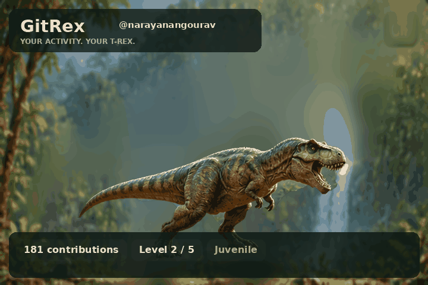

# Publish GitRex to GitHub (Windows PowerShell)

## 0. Preflight

1. Read `ASSET_PROVENANCE.md` and `LICENSE`.
2. Inspect the project files and decide if you want the demo GIF public before the first live workflow run. It has a `DEMO DATA` watermark.
3. Never publish `.venv`, `.env`, `snapshot.json`, tokens, keys, or other private files.
4. Run `RUN_TESTS.bat` and then `RUN_DEMO.bat` locally. Optionally test `RUN_LIVE.bat` to verify the actual GraphQL API connection.

## 1. Authenticate

```powershell
git --version
gh --version
py -3 --version
gh auth login
gh api user --jq .login
```

Make sure the login is the account you intend to publish from.

## 2. Initialize the **separate** GitRex repository

Open PowerShell inside the extracted project folder:

```powershell
git init -b main
git add .
git diff --cached --name-only
git diff --cached --check
git status --short
```

Inspect every staged file, especially under `assets/` and `output/`. If you see any secret or unexpected file, run `git restore --staged path/to/file` and add it to `.gitignore` before continuing.

```powershell
git commit -m "feat: release GitRex v2 with original procedural artwork"
gh repo create narayanangourav/GitRex --public --source=. --remote=origin --push
```

**Do not run `gh repo create` if that remote already exists**. Inspect it first with `gh repo view narayanangourav/GitRex`. Replace the username if different.

## 3. Enable scheduled output generation

Navigate to `GitRex` → `Settings` → `Actions` → `General` → `Workflow permissions`. Permit the workflow to write repository content if it needs to commit new GIFs. The workflow is limited to `contents: write` and does not require a personal token in repository secrets. **Consider branch protections, organization policy and least privileges before enabling writes.**

Run `Actions` → `GitRex profile evolution` → `Run workflow` on `main`.

Check that the render job successfully executes and changes `output/trex.gif`, `output/trex.png` and `output/summary.json` to your real public activity. The workflow is scheduled nightly and may be delayed or disabled after inactivity by GitHub.

## 4. Embed the animation in your profile

In the separate **profile** repository called `narayanangourav/narayanangourav`, edit its `README.md`:

```markdown
## 🦖 My GitRex



[Source](https://github.com/narayanangourav/GitRex)
```

Verify the GIF loads on `https://github.com/narayanangourav`. Do not claim it shows your live figures until the first successful workflow run.

## 5. Security and release notes

- Review third-party Actions and pin to approved commit SHAs in a production environment.
- Enable Dependabot alerts and secret scanning if available.
- Do not commit an authenticated snapshot or a token, even temporarily; removing them in a later commit does not remove them from Git history.
- Read GitHub Actions billing and permissions settings before enabling optional resources.
- Publish a GitHub release from the reviewed commit, not from an unverified ZIP containing demos.
